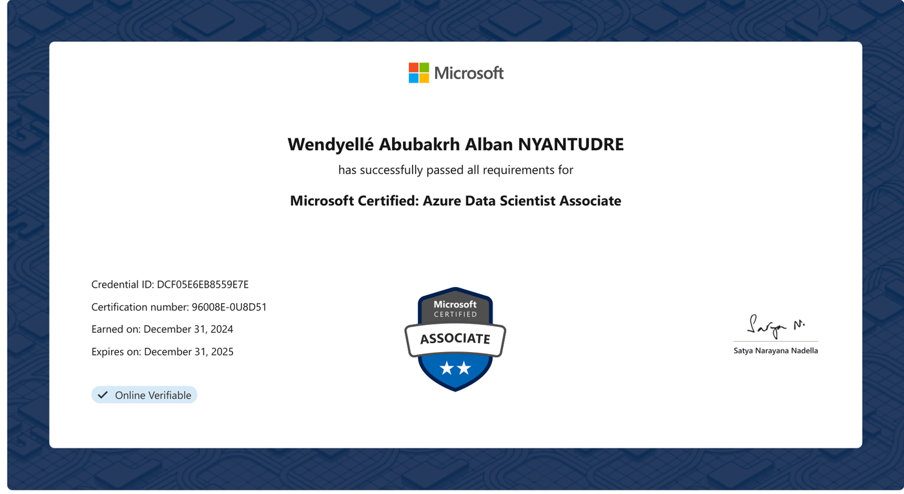
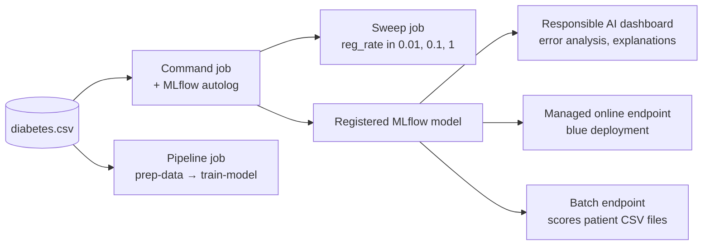

<h1 align="center">Azure Data Scientist Associate (DP-100)</h1>

<p align="center">
  My study notes and lab notebooks for the Microsoft DP-100 exam: designing, training, tracking and deploying machine learning models with Azure Machine Learning.
</p>

<p align="center">
  
  
  
  <a href="LICENSE"></a>
</p>

I prepared the certification with Zindi at the end of 2024 and earned it on 31 December 2024 (valid until 31 December 2025). The repository follows the six parts of the DP-100 learning path on Microsoft Learn. Each part has a short summary per module, and the later parts include the lab notebooks I ran in my own Azure ML workspace.

<p align="center">
  
</p>

The credential can be checked on [Microsoft Learn](https://learn.microsoft.com/en-us/users/waanyantudre/credentials/certification/azure-data-scientist?tab=credentials-tab). A PDF copy is in [`media/azure-data-scientist-credential.pdf`](media/azure-data-scientist-credential.pdf).

## What is inside

| Part | Topics covered in the notes | Labs |
|---|---|---|
| [01. Design a machine learning solution](01.Design%20a%20ML%20solution) | Data ingestion, model training, deployment and MLOps design | |
| [02. Explore and configure the Azure ML workspace](02.Explore%20and%20configure%20the%20Azure%20ML%20workspace) | Workspace resources and assets, developer tools, data, compute targets, environments | |
| [03. Experiment with Azure ML](03.Experiment%20with%20Azure%20ML) | AutoML for classification, MLflow tracking in notebooks | |
| [04. Optimize model training](04.Optimize%20model%20training%20with%20Azure%20ML) | Command jobs, MLflow in jobs, hyperparameter tuning, pipelines | `Lab_09`: sweep job, pipeline job |
| [05. Manage and review models](05.Manage%20and%20review%20models%20in%20Azure%20ML) | Registering MLflow models, the Responsible AI dashboard | `Lab_10`: MLflow logging, Responsible AI dashboard |
| [06. Deploy and consume models](06.Deploy%20and%20consume%20models%20with%20Azure%20ML) | Managed online endpoints, batch endpoints | `Lab_11`: online and batch endpoints |

## The labs

All the labs use the same task: predict whether a patient is diabetic from eight measurements (pregnancies, plasma glucose, blood pressure, triceps thickness, serum insulin, BMI, diabetes pedigree and age). The data is a 10,000-row sample file from the Microsoft lab material, included in the lab folders.



In `Lab_09`, a sweep job tries a grid of regularization rates (0.01, 0.1 and 1) for the training script on a compute cluster, maximizing training accuracy. The second notebook chains two components defined in YAML, `prep-data` and `train-model`, into one pipeline job.

In `Lab_10`, the model is trained with MLflow autologging and registered as `mlflow-diabetes`. A Responsible AI dashboard pipeline then adds error analysis and model explanations to the registered model.

In `Lab_11`, the model goes to a managed online endpoint with a `blue` deployment on a `Standard_D2as_v4` instance. For the patient in `sample-data.json`, it returned "Diabetic". A batch deployment of the same MLflow model scores the four unlabeled files in `Lab_11/data/` and writes the predictions to the workspace datastore.

## Run the labs

The notebooks were run on a compute instance in Azure Machine Learning studio, with the `azure-ai-ml` SDK v2. To run them yourself you need an Azure subscription and an Azure ML workspace:

1. Run the lab's `setup.sh` from the Azure Cloud Shell. It uses the Azure CLI to create a resource group, the workspace, a compute instance and a compute cluster (Lab_09 also registers the training data).
2. Upload the lab folder to the compute instance and open the notebooks there, so that `MLClient.from_config()` finds the workspace.
3. Delete the endpoints and compute when you are done: they are billed while they run.

The notebooks still show their outputs from my runs, including job links into my workspace. Those links only work for accounts with access to it.

## Repository layout

```
├── 01.Design a ML solution/                          # notes only
├── 02.Explore and configure the Azure ML workspace/  # notes only
├── 03.Experiment with Azure ML/                      # notes only
├── 04.Optimize model training with Azure ML/
│   └── Lab_09/   # sweep job, pipeline job, component YAML and scripts
├── 05.Manage and review models in Azure ML/
│   └── Lab_10/   # MLflow logging, Responsible AI dashboard, train/test MLTables
├── 06.Deploy and consume models with Azure ML/
│   └── Lab_11/   # online and batch endpoints, MLflow model, sample data
└── media/        # images used in this README
```

## Resources

- [Microsoft Certified: Azure Data Scientist Associate](https://learn.microsoft.com/en-us/credentials/certifications/azure-data-scientist/), the certification page with the study guide.
- [Basic first project! Azure Machine Learning Easy Getting Starting For Fun and Profit!](https://www.youtube.com/watch?v=US1Mv00MCgo&list=PLwrdxiDe9pXC7DgLRCEmfT0J-lVT5iDoE&index=18) on YouTube.

## Credits

The notes summarize the DP-100 learning path on Microsoft Learn, and the diagrams in the `img/` folders come from it. The lab notebooks, scripts and data come from Microsoft's hands-on labs for the course (`MicrosoftLearning/mslearn-azure-ml`), which I ran and adapted to my workspace. Thanks to [Zindi](https://zindi.africa) for the programme.

My own notes and changes are released under the [MIT License](LICENSE). Microsoft's material keeps its own terms.
